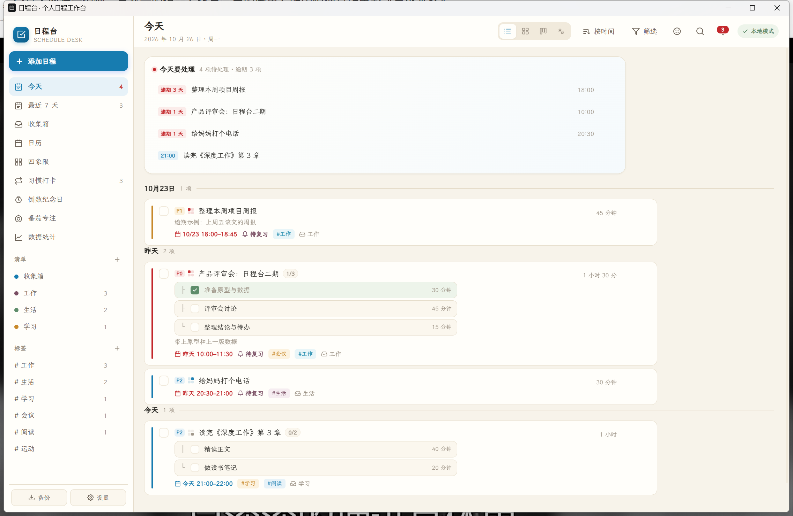

# 日程台 · Schedule Desk

一个本地优先的个人日程工作台：任务、习惯、倒数日、番茄专注、数据统计。
数据存成本机文件，可选 WebDAV 多设备同步，Windows 原生提醒，关闭窗口留驻托盘。



## 功能

- **九个视图**：今天 / 最近 7 天 / 收集箱 / 日历 / 四象限 / 习惯打卡 / 倒数纪念日 / 番茄专注 / 数据统计
- **四种布局**：列表、卡片、看板（按优先级 / 清单 / 标签 / 状态 / 日期分列）、时间线
- **任务**：子任务与多天拆分、标签、清单、优先级、四象限、重复规则、艾宾浩斯复习提醒
- **日历**：年 / 月 / 周 / 多周 / 日 / 多日六种模式，拖拽改期改时
- **五套主题**：宣纸、青瓷、月白、暮色、墨蓝
- **本地优先**：数据是磁盘上的一个 JSON 文件，不依赖任何在线服务
- **可选同步**：WebDAV（坚果云、Nextcloud、群晖等），按记录时间戳合并
- **原生能力**：Windows 通知提醒、托盘常驻、关闭最小化、应用内更新

## 下载与安装

1. 到 [Releases](../../releases) 下载最新的 `ScheduleDesk.zip`
2. 解压到任意目录（**exe 与 `WebView2Loader.dll` 必须放在一起**）
3. 双击 `ScheduleDesk.exe`

首次运行会引导选择数据目录。Windows SmartScreen 可能提示未签名，
点「更多信息 → 仍要运行」即可。

运行环境：Windows 10 1809+ / Windows 11，需要 WebView2 运行时
（Windows 11 与装了 Edge 的系统自带）。

## 数据放在哪

默认 `%APPDATA%\ScheduleDesk\data\`：

```
schedule.json          主数据（schemaVersion + 记录 + 时间戳）
schedule.backup.json   上一版备份
notified.json          已发送的提醒记录
snapshots/             每日快照，保留 7 天
```

设置里可改到任意目录。指向 OneDrive / 坚果云同步盘，等于用网盘做多端同步。

### 网盘目录与 WebDAV 的区别

| | 网盘目录 | WebDAV 同步 |
|---|---|---|
| 原理 | 整个文件由网盘客户端搬运 | 应用自己拉取、按记录合并、再上传 |
| 冲突 | 网盘生成「副本」文件 | 按每条记录的修改时间取新 |
| 删除 | 依赖网盘行为 | 墓碑标记，会同步到其他设备 |

两者不要同时用在同一个目录上，否则会互相干扰。

## 更新

设置 →「检查更新」读取 GitHub Releases 的最新版本，确认后自动下载、
替换程序并重启。更新源是 `config.json` 里的 `repo` 字段（`owner/repo`）。

## 从源码构建

```bash
python build/inject.py                 # 由 index.original.html 生成 index.html
cd src-tauri
cargo build --release                  # 产物 target/release/schedule-desk.exe
```

装有 Visual Studio Build Tools 的机器可直接构建；CI 使用 `windows-latest`。
本仓库开发机没有 MSVC，本地走 Rust GNU 目标，需要 MinGW binutils
（`dlltool`、`windres`），细节见 `build/README-build.md`。

## 目录

```
build/inject.py               前端注入脚本（幂等，可重复执行）
src-web/index.original.html   网页版原始文件（不改动）
src-web/index.html            注入适配层后的构建产物
src-tauri/src/store.rs        数据模型、原子写、快照、记录级合并
src-tauri/src/sync.rs         WebDAV 客户端
src-tauri/src/remind.rs       提醒调度
src-tauri/src/update.rs       GitHub 更新
dist/                         发布产物
CHANGELOG.md                  版本记录
```

## 数据兼容

`schemaVersion` 随结构演进，加载时自动迁移。v1 桌面版留在
`%APPDATA%\com.scheduledesk.app\data.json` 的数据会在首次启动时自动导入。

## 许可

界面与交互设计：workbuddy & bjl1015。
桌面端代码：MIT。
