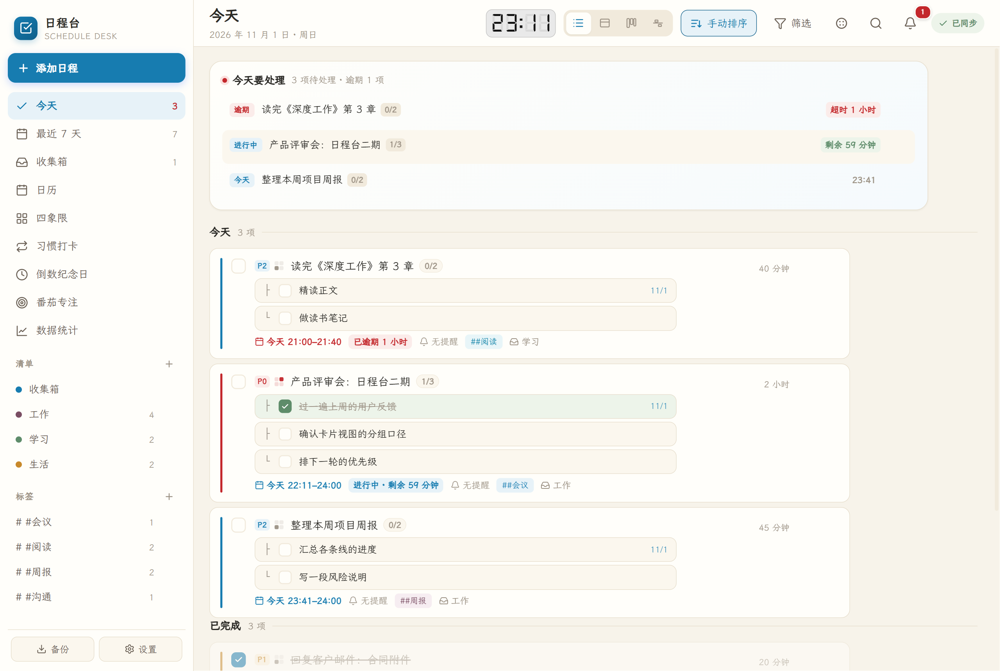

# 日程台 · Schedule Desk

一个本地优先的个人日程工作台：任务、习惯、倒数日、番茄专注、数据统计。
数据存成本机文件，可选 WebDAV 多设备同步，Windows 原生提醒，关闭窗口留驻托盘。



## 功能

- **九个视图**：今天 / 最近 7 天 / 收集箱 / 日历 / 四象限 / 习惯打卡 / 倒数纪念日 / 番茄专注 / 数据统计
- **四种布局**：列表、卡片、看板（按优先级 / 清单 / 标签 / 状态 / 日期分列）、时间线
- **任务**：子任务与多天拆分、标签、清单、优先级、四象限、重复规则、艾宾浩斯复习提醒
- **日历**：年 / 月 / 周 / 多周 / 日 / 多日六种模式，拖拽改期改时
- **五套主题**：宣纸、青瓷、月白、暮色、墨蓝
- **本地优先**：数据是磁盘上的一个 JSON 文件，不依赖任何在线服务
- **可选同步**：WebDAV（坚果云、Nextcloud、群晖等），按记录时间戳合并
- **原生能力**：Windows 通知提醒、托盘常驻、关闭最小化、应用内更新

## 下载与安装

1. 到 [Releases](../../releases) 下载 `ScheduleDesk.zip`，或直接取 `ScheduleDesk.exe`
2. 解压到任意目录，双击 `ScheduleDesk.exe`
3. 首次运行会引导选择数据目录

Release 里的 exe 是**单文件**：WebView2 加载器已静态链接进程序，不需要旁边放 DLL。
只有自行用 GNU 工具链构建时，才需要把 `WebView2Loader.dll` 放在同目录。

**关于 SmartScreen**：未签名的程序首次运行可能提示「Windows 已保护你的电脑」。
两种处理方式，选一种即可：

- 解压前右键 zip → 属性 → 勾选「解除锁定」→ 确定（推荐，之后不再提示）
- 或在提示里点「更多信息 → 仍要运行」

已经解压的，可在程序目录执行 `Get-ChildItem -Recurse | Unblock-File`，
效果相同。这个提示与程序本身无关，是 Windows 对「来自网络且无下载记录的文件」
的默认拦截；用的人多了会自行消失。

运行环境：Windows 10 1809+ / Windows 11，需要 WebView2 运行时
（Windows 11 与装了 Edge 的系统自带）。

## 数据放在哪

默认 `%APPDATA%\ScheduleDesk\data\`：

```
schedule.json          主数据（schemaVersion + 记录 + 时间戳）
schedule.backup.json   上一版备份
notified.json          已发送的提醒记录
snapshots/             每日快照，保留 7 天
```

设置里可改到任意目录。指向 OneDrive / 坚果云同步盘，等于用网盘做多端同步。

### 网盘目录与 WebDAV 的区别

| | 网盘目录 | WebDAV 同步 |
|---|---|---|
| 原理 | 整个文件由网盘客户端搬运 | 应用自己拉取、按记录合并、再上传 |
| 冲突 | 网盘生成「副本」文件 | 按每条记录的修改时间取新 |
| 删除 | 依赖网盘行为 | 墓碑标记，会同步到其他设备 |

两者不要同时用在同一个目录上，否则会互相干扰。

## 更新

设置 →「检查更新」读取 GitHub Releases 的最新版本，确认后自动下载、
替换程序并重启。Release 同时提供裸 exe 与 zip：更新器取 exe，手动下载取 zip。
更新源是 `config.json` 里的 `repo` 字段（`owner/repo`）。

未认证的 GitHub API 每小时有 60 次配额，被限流时设置面板会显示具体原因，
不会提示「已是最新」。

## 从源码构建

前端是 Svelte 5 + TypeScript + Vite，桌面壳是 Tauri 2。

```bash
bun install
bun run build                          # src-web/ → src-web/build/（Tauri 的 frontendDist）
bash build/build.sh                    # 前端 + exe，产物落 dist/ScheduleDesk.exe
```

只想看界面：`bun run dev` 打开 `http://127.0.0.1:3000`。没有 Tauri 宿主时会自动装一层
内存桥（数据存 localStorage），交互与真机走同一套代码。`?reset=1` 清空预览数据，
`?onboard=1` 走首次引导。

`build/build.sh` 里有一个必须记住的点：前端产物是编译期被 `tauri::generate_context!`
嵌进 exe 的，而 tauri-build 不对 `frontendDist` 发 rerun-if-changed —— 只改前端时
cargo 会判定「无变更」并静默复用旧 exe，所以脚本会先 `touch src-tauri/src/main.rs`
强制重新嵌入。

装有 Visual Studio Build Tools 的机器可直接构建，产物为单文件；
CI 使用 `windows-latest`，同样输出无需 DLL 的 exe。
本仓库开发机没有 MSVC，本地走 Rust GNU 目标，需要 MinGW binutils
（`dlltool`、`windres`）与 `WebView2Loader.dll` 同目录运行。

## 目录

```
package.json                  前端依赖与脚本（bun）；运行时只有 floating-ui 与 lucide 两个本地包
vite.config.ts                前端构建配置，产物直出 src-web/build
src-web/index.html            Vite 入口骨架
src-web/src/main.ts           挂载应用、装桥接、启动数据与时钟
src-web/src/App.svelte        应用外壳：侧栏 / 顶栏 / 内容 / 各种浮层
src-web/src/styles.css        样式入口，只留 @import；实现按层拆在 styles/ 下
src-web/src/styles/            变量与重置 / 骨架 / 视图 / 弹窗 / 表单 / 换肤（5 套主题靠 html[data-theme]）
src-web/src/lib/domain/       纯领域层：类型、日期、任务窗口与状态机、选择器、示例数据
src-web/src/lib/bridge/       与 Tauri 的通道：invoke、数据库门面、桌面能力、导出、预览内存桥
src-web/src/lib/store/        响应式状态（runes）：数据、视图、时钟、模态、提示、主题…
src-web/src/lib/components/   通用组件：任务行、状态胶囊、侧栏、顶栏、铃铛、时钟…
src-web/src/lib/ui/icons.ts   图标表：42 条走 @lucide/svelte，5 条自制 path
src-web/src/lib/views/        九个视图 + 四种布局 + 六种日历模式 + 各类编辑器
src-web/src/lib/actions/      动作：浮层定位、传送门、拖拽控制器、value 契约
src-web/src/lib/test/         测试门面，只给 build/ui-check.mjs 用
src-web/build/                构建产物，不入库（Tauri 的 frontendDist）
src-tauri/src/store.rs        数据模型、原子写、快照、记录级合并
src-tauri/src/sync.rs         WebDAV 客户端
src-tauri/src/remind.rs       提醒调度
src-tauri/src/update.rs       GitHub 更新
build/build.sh                本机一键构建（前端 + exe → dist/）
build/ui-check.mjs            界面回归：54 条断言 + 截图（状态矩阵 / 浮层 / 图标 / 字体 / 编辑器交互，走 CDP）
docs/                         截图、使用说明、日程台-功能表.md（完整功能手册）
dist/                         本地构建输出，不入库
CHANGELOG.md                  版本记录
```

**`src-web/src` 是唯一维护对象**，改动直接写进对应模块；`src-web/build` 是产物，
每次构建整体重生成。领域层不碰 DOM、不碰 Tauri，能脱离界面单测
（`bun test`，60 条断言覆盖状态矩阵、提醒节点、拆分排期、快速解析、日历分道与贴边钳制）。

## 文档

- [功能与操作手册](docs/日程台-功能表.md)：界面每一处能点、能拖的地方，以及状态判定规则
- [使用说明](docs/使用说明.txt)：随包附带，讲数据位置、同步、提醒与托盘
- [更新日志](CHANGELOG.md)：每个版本改了什么

## 数据兼容

`schemaVersion` 随结构演进，加载时自动迁移。v1 桌面版留在
`%APPDATA%\com.scheduledesk.app\data.json` 的数据会在首次启动时自动导入。

## 许可

界面与交互设计：workbuddy & bjl101501。
桌面端代码：MIT。
